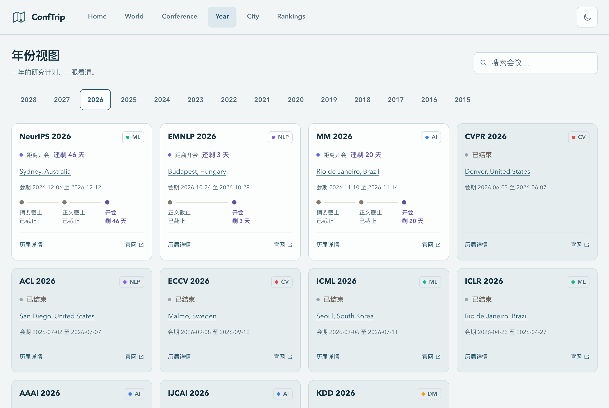

<h1 align="center">ConfTrip</h1>

<p align="center">
  <strong>Discover a conference. Explore a city.</strong><br />
  AI conference dates, destinations, and places to look forward to.
</p>

<p align="center">
  <a href="./README.md"></a>
  <a href="./README.en.md"></a>
</p>

<p align="center">
  <a href="https://aitravel.gonsun.com/"><strong>Start exploring ↗</strong></a>
  &nbsp; · &nbsp;
  <a href="https://aitravel.gonsun.com/#/conference">Conferences</a>
  &nbsp; · &nbsp;
  <a href="https://aitravel.gonsun.com/#/rankings">Rankings</a>
</p>

<p align="center"><sub>No sign-up · Mobile layouts · Dark mode</sub></p>


## From the next paper to the next destination

ConfTrip brings conference dates, past host cities, and travel information together for AI researchers and students. Plan a submission, then get to know the city you might visit next.

- **Plan your research calendar** — Follow events in [Conference view](https://aitravel.gonsun.com/#/conference), or browse a year of submissions and conference dates in [Year view](https://aitravel.gonsun.com/#/year).
- **Explore a destination** — Rotate the [globe](https://aitravel.gonsun.com/#/world), or open the [city directory](https://aitravel.gonsun.com/#/cities) for sights, seasons, food, and associated conferences.
- **Discover shared interests** — Browse [Rankings](https://aitravel.gonsun.com/#/rankings) for historical hosts and the conferences and cities attracting attention.
- **Share your next destination** — [Vote for a city](https://aitravel.gonsun.com/#/rankings?board=city-wishlist) you would like to host a future conference, or leave a like on the homepage to encourage the project.

## Follow research around the world

One city may have hosted many academic encounters. Rotate the globe, locate host cities, and explore the geography of AI conferences. Zoom in to discover original miniature landmarks in selected cities.


## Four boards, four perspectives

Use the homepage arrows to switch boards, or open **Rankings** for the complete lists. Search preserves the original ranks, and equal totals share a rank.

| Board                                                                               | Ranked by                                              |
| :---------------------------------------------------------------------------------- | :----------------------------------------------------- |
| [Host cities](https://aitravel.gonsun.com/#/rankings?board=hosting)                 | Recorded historical in-person conference editions      |
| [Conference interest](https://aitravel.gonsun.com/#/rankings?board=conference-heat) | Deliberate conference clicks, combined across editions |
| [City interest](https://aitravel.gonsun.com/#/rankings?board=city-heat)             | Deliberate city clicks                                 |
| [City wishlist](https://aitravel.gonsun.com/#/rankings?board=city-wishlist)         | Votes for a city to host a future conference           |

**Where would you like to attend a conference next?** Search for a city already in the directory and tap its heart to add a vote. Voting is connected to site-wide totals and supports repeat votes; the feature and experience are still being refined.

The homepage like button also supports repeated clicks, with a `+1` animation. Project likes and city votes are counted separately.

<details>
<summary>How the rankings are counted</summary>

- The host-city board includes only historical in-person editions in this project's dataset. Online and future editions are excluded.
- Interest counts deliberate clicks. Refreshing, hovering, filtering, changing years, and switching boards do not add counts.
- Repeat clicks and votes count separately. Totals represent interactions rather than unique visitors; entries with no clicks or votes remain unranked.

</details>

## More views

Expand a section to view its full-size images. Screenshots come from local preview, with some interactions in browser-local mode. Visit the [production site](https://aitravel.gonsun.com/) for current dates, countdowns, and site-wide totals.

<details>
<summary><strong>Conferences · Follow an event through its editions</strong></summary>

Search by name, filter by research area, and browse editions horizontally to find milestones, destinations, and official websites.


</details>

<details>
<summary><strong>Years · See a year of research events together</strong></summary>

Choose a year to browse conference cards and milestones for abstracts, papers, and conference dates.



</details>

<details>
<summary><strong>Cities · Get to know the destination</strong></summary>

Search cities and countries, filter by continent, and browse available travel guides. Conference records remain accessible for cities without a guide.


</details>

<details>
<summary><strong>Rankings · From past hosts to future hopes</strong></summary>

The host-city board shows full rankings, associated conferences, and year ranges. The city wishlist lets you vote for a destination you hope to visit.


</details>

## Conferences covered

The project currently covers 13 AI conferences, including historical host information and published details for future editions.

| Area                        | Conferences           |
| :-------------------------- | :-------------------- |
| Computer vision             | CVPR · ICCV · ECCV    |
| Natural language processing | ACL · EMNLP · NAACL   |
| Machine learning            | NeurIPS · ICML · ICLR |
| General AI and multimedia   | AAAI · IJCAI · ACM MM |
| Data mining                 | KDD                   |

Conference information lives in static JSON. Scheduled AI-assisted research and validation create an update PR when data changes; updates are published after review and merge. Confirm dates and time zones on the official conference website. Unconfirmed information is marked “待公布” (to be announced).

Travel guides cover selected cities. This README is available in Chinese and English; most website interface text is currently in Chinese.

## What's next

- Refine city wishlist voting and add more city travel guides.
- Introduce calendar export, deadline notifications, and conference bookmarks.
- Add a Chinese/English switch to the website interface.

The last two items are planned and are not yet available. Tell us what would help you in an [Issue](https://github.com/yinwen2019/conftrip/issues).

## Run locally

Use Node.js 24 and npm:

```bash
git clone https://github.com/yinwen2019/conftrip.git
cd conftrip
npm ci
npm run dev
```

Open the address printed in your terminal, normally `http://localhost:5173`. No AI service key is needed to run the frontend.

<details>
<summary><strong>Development and data maintenance</strong></summary>

**Stack**

Vue 3, TypeScript, Vite, Tailwind CSS, Vue Router, Three.js / Globe.GL, and D3 Geo. GitHub Pages hosts the frontend; an independent Cloudflare Worker + D1 service handles site-wide interactions.

**Project structure**

```text
data/                Conference data, city guides, and schemas
src/                 Pages, components, and read-only aggregation
scripts/             Validation and AI-assisted updates
services/analytics/  Independent interaction statistics
.docs/               Requirements and developer documentation
```

**Checks before submitting**

```bash
npm run validate
npm run type-check
npm run build
```

Include official sources with data changes, and verify dates and time zones. See [AGENTS.md](AGENTS.md) for conventions and the [schema documentation](.docs/04-data-schema.md) for data formats. The AI update script needs Python 3.11+ and service configuration; see the [update pipeline](.docs/08-ai-update-pipeline.md) and [.env.example](.env.example). Internal documentation is primarily in Chinese.

**Local interaction service**

Without a configured statistics API, likes and city votes stay in the current browser, and interest boards show that collection is disabled. Local totals are never automatically uploaded; development mode also blocks writes to the production statistics service.

For integration work, use the isolated local test database:

```bash
npm run analytics:db:local
npm run analytics:dev
# Start the frontend in another terminal
VITE_ANALYTICS_API_URL=http://127.0.0.1:8788 npm run dev
```

See the [statistics service README](services/analytics/README.md) and [integration documentation](.docs/21-analytics-service-result.md).

</details>

---

If ConfTrip helps you plan a submission or look forward to a new city, bookmark the [website](https://aitravel.gonsun.com/) or give the project a ⭐. Follow updates on [Xiaohongshu](https://xhslink.cn/o/5YIh8OKvkvn).
