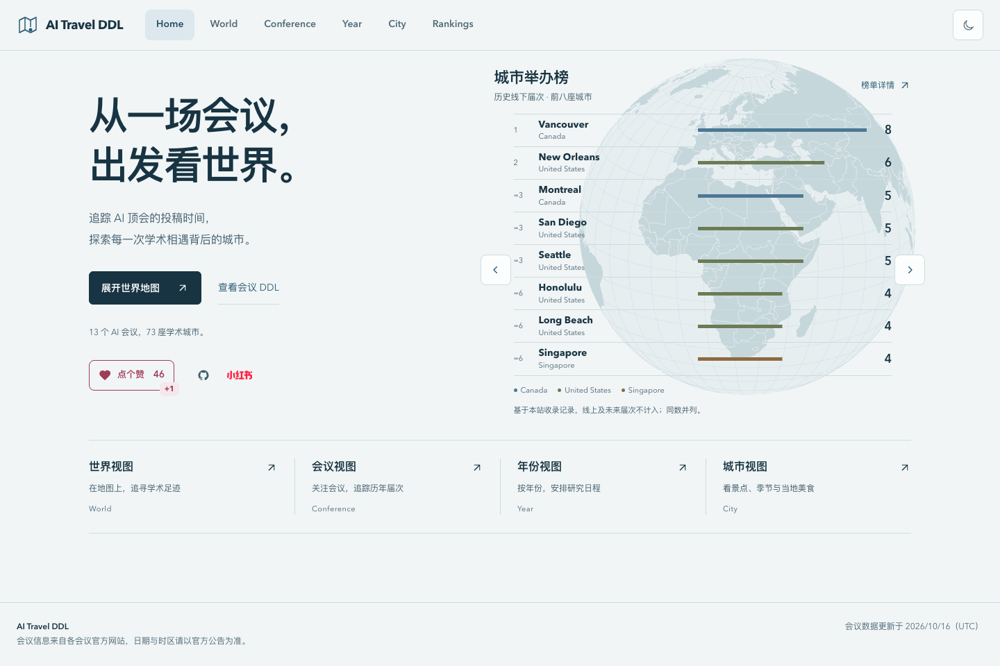
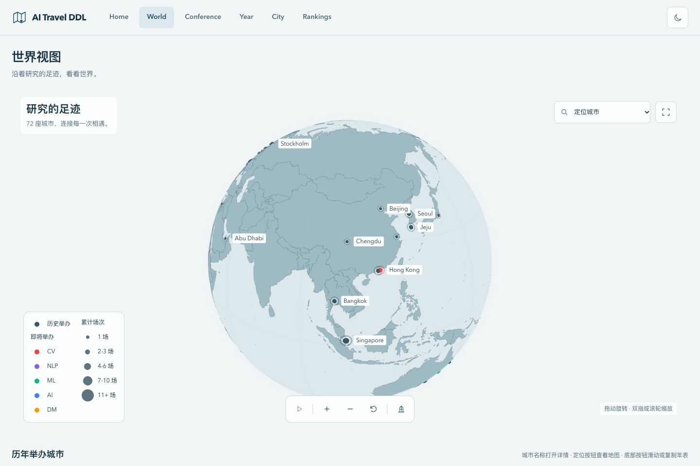
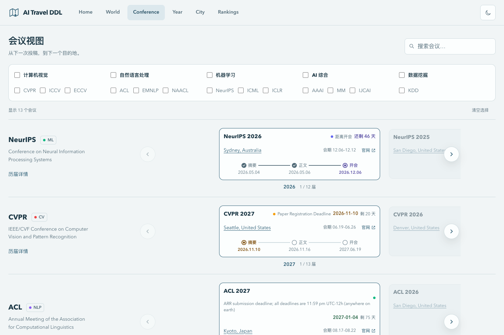
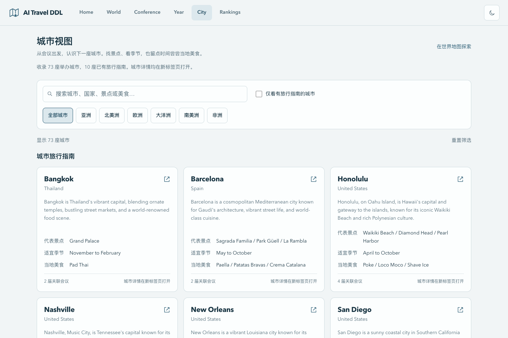
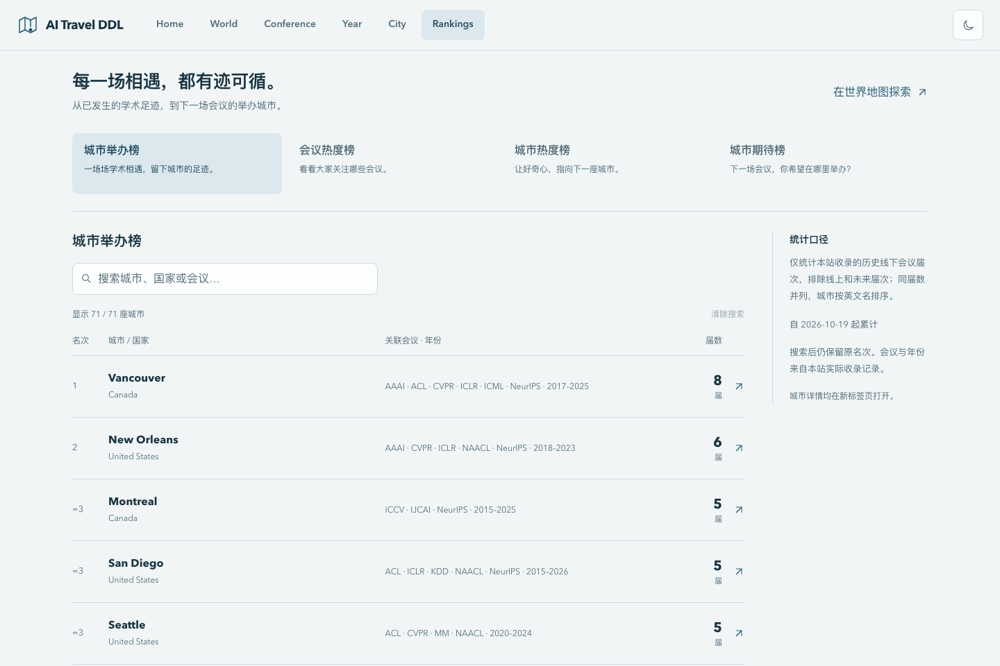
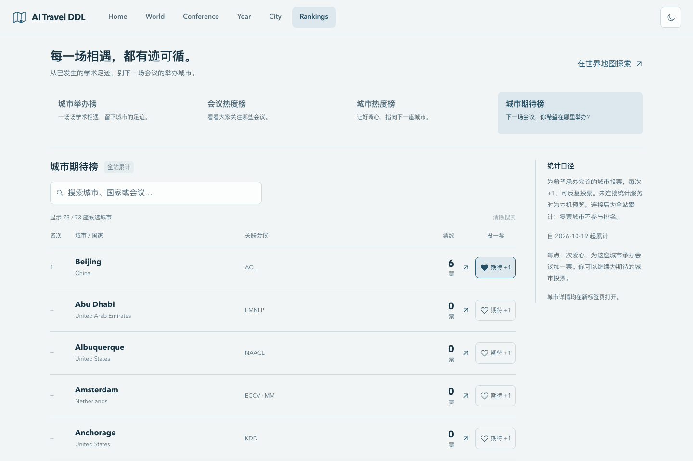

<div align="center">

# ConfTrip ✈️

### 从一场会议，出发看世界。

面向 AI 研究者与学生的会议日程与目的地导航。<br />
查投稿 DDL、探索举办城市，也为期待的下一站投一票。

<p>
  <a href="./README.md"></a>
  <a href="./README.en.md"></a>
</p>

**[打开网站 →](https://aitravel.gonsun.com/)** · [查看会议 DDL](https://aitravel.gonsun.com/#/conference) · [查看排行榜](https://aitravel.gonsun.com/#/rankings)

无需注册 · 浏览器直接使用 · 支持手机与深色模式

</div>

[](https://aitravel.gonsun.com/)

## 写完论文，也期待下一次出发

准备投稿时，我们关心摘要和正文什么时候截止；准备参会时，又开始关心会议在哪座城市、什么时候举办、附近有什么值得看看。

ConfTrip 把这些信息串在一起：从关注一场会议，到安排一年的研究日程，再到探索会议背后的城市。现在，你还可以通过排行榜了解大家关注的会议与城市，为希望未来承办会议的城市投票，或在首页点个赞，给项目一点鼓励。

## 你想从哪里开始？

| 你想做的事 | 从这里进入 | 可以看到什么 |
| --- | --- | --- |
| 关注某个会议，查看下一届安排 | [会议视图](https://aitravel.gonsun.com/#/conference) | 按会议搜索、分类筛选；逐行浏览历年届次、日期节点、举办地与官网 |
| 把一年的投稿安排放在一起看 | [年份视图](https://aitravel.gonsun.com/#/year) | 按年份浏览会议卡片，查看摘要、正文、开会与结束等节点及倒计时 |
| 看看 AI 会议把研究者带到了哪里 | [世界视图](https://aitravel.gonsun.com/#/world) | 交互式三维地球、会议城市分布与历年举办城市表，支持城市定位 |
| 提前了解参会目的地 | [城市视图](https://aitravel.gonsun.com/#/cities) | 搜索城市与国家，按大洲或旅行指南筛选，查看关联会议与已收录的旅行资料 |
| 看看大家关注哪里，表达下一站期待 | [排行榜 Rankings](https://aitravel.gonsun.com/#/rankings) | 切换四类榜单、搜索完整排名，并为希望承办会议的城市投票 |

## 从学术足迹，到下一站期待

首页右侧可以通过左右箭头**手动切换四类榜单**；点击「榜单详情」或顶部 **Rankings**，进入完整排行榜。排行榜支持搜索，筛选后保留原榜单名次。

| 榜单 | 看什么 | 统计口径 |
| --- | --- | --- |
| [城市举办榜](https://aitravel.gonsun.com/#/rankings?board=hosting) | 哪些城市留下了更多学术足迹 | 按本站收录的历史线下会议届数排名，不计线上会议与未来届次 |
| [会议热度榜](https://aitravel.gonsun.com/#/rankings?board=conference-heat) | 大家正在关注哪些会议 | 按会议对象的主动点击次数累计，同一会议跨年份合并 |
| [城市热度榜](https://aitravel.gonsun.com/#/rankings?board=city-heat) | 哪些目的地更让人好奇 | 按城市对象的主动点击次数累计 |
| [城市期待榜 · 完善中](https://aitravel.gonsun.com/#/rankings?board=city-wishlist) | 下一场会议，你希望在哪里举办 | 在已收录城市中投票，每次有效点击加一票，支持重复投票 |

热度与期待按累计次数排序，同数并列；零次点击或零票的对象暂不参与对应排名。热度只记录主动操作，刷新、悬停、筛选、切年与轮播不计入。**重复点击和投票分别累计，因此次数与票数不代表独立用户人数。**

### 下一场会议，你希望在哪里参会？

进入[城市期待榜](https://aitravel.gonsun.com/#/rankings?board=city-wishlist)，搜索你向往的城市，点击爱心，为它承办未来会议增加一份期待。投票与全站累计已接入，相关功能和体验仍在持续完善。

首页的「点个赞」则用于鼓励项目：无需登录，点击爱心会出现 `+1` 动效，可以连续点赞。**项目点赞与城市投票分别累计**；首页还提供 GitHub 与小红书入口，方便收藏项目和关注动态。

## 实际界面

### 在世界地图上，追寻学术足迹

拖动地球、定位城市，查看会议在世界各地的分布。放大后，部分城市还可以探索原创微缩地标。

[](https://aitravel.gonsun.com/#/world)

<details>
<summary><strong>查看会议视图：从下一次投稿，到下一个目的地</strong></summary>

每个会议独占一行，左右切换不同年份；搜索和分类筛选帮助你聚焦关注的会议。

[](https://aitravel.gonsun.com/#/conference)

</details>

<details>
<summary><strong>查看城市视图：看景点、季节与当地美食</strong></summary>

从会议举办地进入城市详情，查看已有的气候、景点、美食、旅行贴士与全部关联会议。旅行指南目前覆盖部分城市，其余城市仍可查看会议记录。

[](https://aitravel.gonsun.com/#/cities)

</details>

<details>
<summary><strong>查看完整排行榜与城市期待投票</strong></summary>

城市举办榜展示城市、国家、关联会议、年份范围与累计届数；其余榜单展示对应的点击次数或期待票数。

[](https://aitravel.gonsun.com/#/rankings)

[](https://aitravel.gonsun.com/#/rankings?board=city-wishlist)

</details>

截图为正式网站的展示快照；会议日期、倒计时、榜单数据与覆盖范围会持续变化，请以网站当前展示为准。

## 收录会议

目前收录以下 13 个 AI 会议，包含历年举办信息与已公布的未来届次信息：

| 领域 | 会议 |
| --- | --- |
| 计算机视觉 | CVPR · ICCV · ECCV |
| 自然语言处理 | ACL · EMNLP · NAACL |
| 机器学习 | NeurIPS · ICML · ICLR |
| AI 综合与多媒体 | AAAI · IJCAI · ACM MM |
| 数据挖掘 | KDD |

欢迎通过 [Issue](https://github.com/yinwen2019/conftrip/issues) 提议补充会议，或纠正日期与举办地点。

## 数据与功能说明

- **信息维护**：会议数据保存在版本管理中的 JSON 文件中；GitHub Actions 定期运行 AI 辅助检索与校验，有变更时创建更新 PR，审核合并后发布。
- **日期核对**：会议安排可能调整，投稿截止日期及其时区、注册与出行信息请以对应会议官网为准。尚未确认的信息显示「待公布」。
- **旅行资料**：旅行指南仅覆盖部分城市；原创三维地标是城市意象，不代表真实布局或会议场馆。
- **互动统计**：正式网站通过独立统计服务累计点赞、会议与城市点击、城市期待票；会议与旅行资料继续使用静态 JSON。互动统计与基础信息浏览相互独立。
- **语言支持**：README 支持中英文切换，网站界面目前以中文为主。

### 当前进展

| 状态 | 功能 |
| --- | --- |
| 已提供 | 会议／年份／世界／城市四个功能视图，首页四榜切换与独立 Rankings 页面 |
| 已接入 | 全站点赞、会议热度、城市热度与城市期待累计 |
| 持续完善 | 希望参会城市的投票体验、城市旅行资料 |
| 计划中 | 日历导出、Deadline 提醒、会议收藏、网站中英文切换 |

欢迎通过 [Issue](https://github.com/yinwen2019/conftrip/issues) 提交反馈。计划中的功能目前尚未提供。

## 本地运行与贡献

只想查会议信息？直接[打开网站](https://aitravel.gonsun.com/)即可，无需安装或配置 API Key。

如需本地开发，使用 Node.js 24（与本项目 GitHub Actions 一致）及 npm：

```bash
git clone https://github.com/yinwen2019/conftrip.git
cd conftrip
npm ci
npm run dev
```

打开终端显示的本地地址，默认为 `http://localhost:5173`。

<details>
<summary><strong>开发说明：技术栈、项目结构与常用命令</strong></summary>

**网站**：Vue 3 · TypeScript · Vite · Tailwind CSS · Vue Router（Hash 路由）· Three.js / Globe.GL · D3 Geo · GitHub Pages。

**数据与互动**：JSON Schema / Ajv · Python · GitHub Actions；全站互动由独立 Cloudflare Worker + D1 提供。

```text
data/                会议数据、城市旅行资料与校验 Schema
src/                 页面、组件、只读数据聚合与样式
scripts/             数据校验与 AI 辅助更新脚本
services/analytics/  独立统计 API、数据库迁移与隔离测试
public/              网站静态资源
.github/             自动更新、部署流程与 README 图片
.docs/               需求、架构与实现说明
```

| 命令 | 用途 |
| --- | --- |
| `npm run dev` | 启动本地开发服务 |
| `npm run validate` | 校验会议与城市 JSON 数据 |
| `npm run type-check` | TypeScript 类型检查 |
| `npm run build` | 数据校验并构建生产版本 |
| `npm run preview` | 预览构建结果 |
| `npm run lint` | ESLint 检查并自动修复 |
| `npm run format` | 格式化前端代码 |

前端本地运行不需要 AI 服务密钥。若要运行数据更新脚本，请参阅 [AI 更新流程](.docs/08-ai-update-pipeline.md) 与 [.env.example](.env.example)，使用 Python 3.11+ 并配置所需服务。

**本地互动预览**：未配置统计 API 时，点赞和城市期待仅保存在当前浏览器，会议与城市热度显示未开启。本机累计不会自动上传成全站数据；开发模式禁止向正式统计服务提交，避免调试操作影响真实榜单。

如需联调完整互动流程，请先参阅 [统计服务说明](services/analytics/README.md) 与 [全站统计接入文档](.docs/21-analytics-service-result.md)，使用独立的本地测试数据库：

```bash
npm run analytics:db:local
npm run analytics:dev
# 在另一终端启动前端
VITE_ANALYTICS_API_URL=http://127.0.0.1:8788 npm run dev
```

Cloudflare 服务配置与前端静态托管分别维护；普通网站浏览和本地前端预览不需要部署统计服务。

</details>

欢迎修正会议信息、补充城市资料，或改进界面。提交数据变更时，请附上官方来源链接、核对日期与时区，并运行：

```bash
npm run validate
npm run type-check
npm run build
```

开发约定见 [AGENTS.md](AGENTS.md)，数据格式见 [数据 Schema 说明](.docs/04-data-schema.md)。

---

如果它帮你安排了下一次投稿，或让你开始期待下一座城市，欢迎收藏[网站](https://aitravel.gonsun.com/)、点个赞，或给项目一个 ⭐。也可以在[小红书](https://xhslink.cn/o/5YIh8OKvkvn)关注项目动态。

**Finish the paper, catch the flight, and explore the world.**
